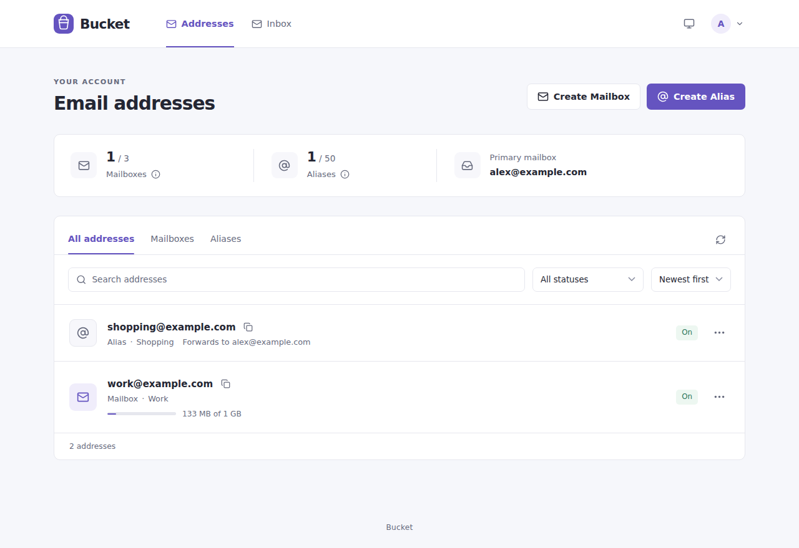
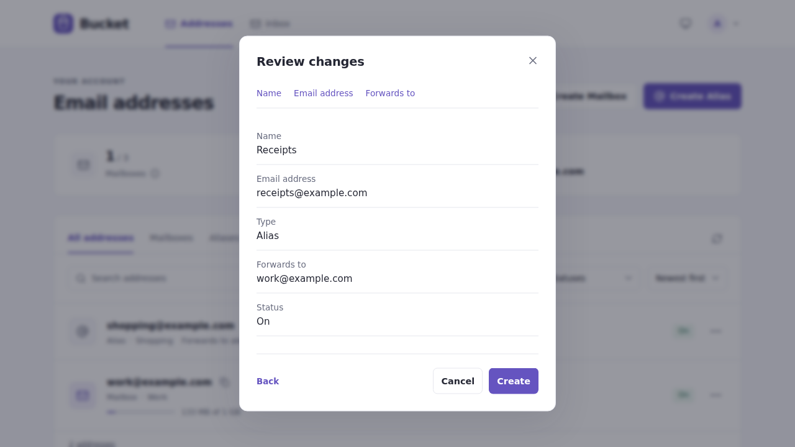
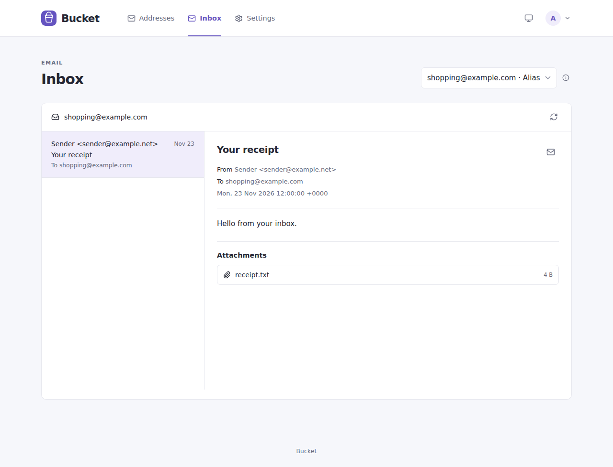
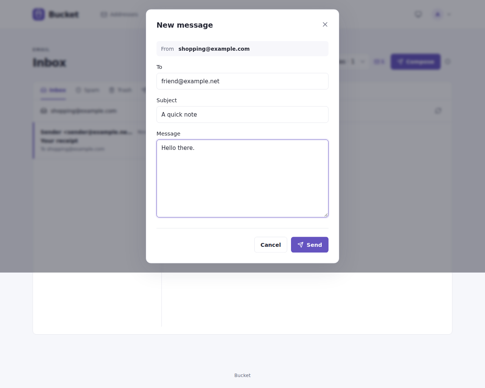

# Bucket

**A simpler way to manage email addresses on your Mailcow server.**

Bucket started with one goal: make creating an email address quick enough that you actually bother to use a different one for each website, app, or mildly suspicious newsletter.

Sign in with your existing Mailcow mailbox, create an alias, and get on with your day. Your primary email address doesn't need to attend every mailing list.

Bucket was built for people who want **more privacy and anonymity online**, with ease of use at the center. It starts with keeping online identities separate. Give each service its own address, keep your main address to yourself, and turn off an alias when it starts attracting unwanted attention. Separate mailboxes are available when you want a separate inbox, too.

Aliases can help with privacy and pseudonymity, but they don't make you untraceable: your domain, mail server, and message headers can still connect identities. Bucket makes address management easier; it isn't an invisibility cloak. Sadly, Docker doesn't ship one of those yet.

## A look inside

Screenshots use demo addresses and messages, not someone's actual inbox.

### Your addresses

Mailboxes and aliases in one place, with search, filters, storage usage, and quick management actions.



### Create an alias

Start with a name, get a suggested address such as `shopping-a7k@example.com`, and choose where messages go. The random suffix is optional, and Bucket remembers your preference. Review everything before creating it, or create directly from the forwarding step.



### Read your mail

Switch between your mailboxes and aliases to see messages matching that address. Read messages, download attachments, and mark mail read or unread.



Write a quick message from the selected address.



## What you get

- **Aliases for different parts of your life.** Forward to your primary mailbox or another mailbox you own. Rename, copy, turn off, or delete them when needed.
- **Independent mailboxes.** Create an inbox with its own password, generate a strong password, and manage storage space.
- **A lightweight inbox.** Read messages and attachments, copy detected verification codes with one click, write a quick reply, or compose a plain-text message. Move mail to Spam or Trash, restore it, and browse Sent. New mail refreshes every 30 seconds while Bucket is open, with unread badges for each address.
- **Simple administration.** Choose allowed domains, approve people, set limits, review ownership problems, and inspect activity. No public signup.
- **A comfortable interface.** Light, dark, and system themes; desktop and mobile layouts; keyboard support; and an installable PWA.

Mailcow keeps doing the actual mail-server work. Bucket provides the smaller set of controls you need most often.

## Basic setup

You'll need an existing Mailcow installation, Docker with Compose, an HTTPS reverse proxy, and an existing Mailcow mailbox for your initial administrator. Bucket can run on a different machine from Mailcow.

### 1. Prepare Mailcow

Create a **read-write administrator API key** in Mailcow under **System → Configuration → Access → Administrators → API**. Restrict it to the source IP Mailcow sees from Bucket. Docker or VPN routing may make that different from the host's IP.

The Bucket container must be able to reach Mailcow's web API, TLS IMAP service, and SMTP submission service for sending.

### 2. Configure Bucket

Clone or download this repository, then run:

```sh
cp .env.example .env
chmod 600 .env
```

Edit `.env` with your own connection details:

```dotenv
BUCKET_PUBLIC_URL=https://bucket.example.com
BUCKET_MAILCOW_URL=https://mail-admin.example.com
BUCKET_MAILCOW_API_KEY=your-read-write-api-key
BUCKET_IMAP_HOST=mail.example.com
BUCKET_IMAP_PORT=993
BUCKET_ADMIN_EMAIL=you@example.com
```

`BUCKET_MAILCOW_URL` is the **web UI's HTTPS origin**, without `/api/v1`. `BUCKET_IMAP_HOST` is the **mail server's IMAP hostname**. They can be different. All connections must have valid, trusted TLS certificates. Sending defaults to the IMAP hostname on port 587 with required STARTTLS; use `BUCKET_SMTP_HOST`, `BUCKET_SMTP_PORT`, and `BUCKET_SMTP_SECURITY=tls` for a different server or implicit TLS on port 465.

The administrator email must be a full, existing mailbox address, **not** the Mailcow web administrator username.

### 3. Start it

Build and run locally using Compose:

```sh
docker compose -f compose.yaml -f compose.build.yaml up -d --build
```

Prefer a published image? Compose uses `ghcr.io/galgathor/bucket:latest` directly. To pin a version, change the `image` field in `compose.yaml`. Sign in with `docker login ghcr.io` if the package is private, then use:

```sh
docker compose pull
docker compose up -d
```

Point your HTTPS reverse proxy at Bucket's port `8080`. The default host binding is `127.0.0.1:8080`; a container-based proxy such as Nginx Proxy Manager should use a shared proxy network and forward to `bucket:8080`. See the [operations guide](docs/operations.md#nginx-proxy-manager-in-docker) for that configuration.

### 4. Choose who can use it

Open Bucket at your configured URL and sign in as the initial administrator. In **Settings**, test the connection, select domains, and save your limits. Under **People**, enable the existing Mailcow accounts allowed to sign in.

That's the infrastructure part done. Everyone else gets to click **Create Alias** or **Create Mailbox**.

## A few things to know

- Login supports locally authenticated Mailcow mailboxes over TLS IMAP. IMAP-enabled app passwords work when your Mailcow policy permits them. Browser SSO and interactive MFA flows aren't implemented.
- Compose and reply use plain text; outgoing attachments, rich text, arbitrary folders, permanent deletion, and native Mailcow expiring aliases are not included. Sending from aliases requires Mailcow’s permission to send as that address.
- Address filtering relies on recipient and delivery headers. Some Bcc, forwarded, or mailing-list messages can't reliably be attributed to an alias.
- Bucket manages addresses it creates; it doesn't automatically adopt unrelated accounts already in Mailcow.
- Mailbox passwords aren't saved. The API key stays on the backend. Message HTML is sanitized, and remote images and scripts are blocked.

## Under the hood

Rust with Axum, React with TypeScript, and SQLite, packaged in one container. No Redis side quest required.

Application data lives in a persistent Docker volume. Keep backups of that volume and your private `.env`; Mailcow's messages need their own backups. Run one Bucket instance per database.

For published-image deployments, update with `docker compose pull && docker compose up -d`. For local builds, rerun the build command after pulling changes. Back up first when upgrading, and don't use `docker compose down -v` unless you mean to remove the application data.

## Digging deeper

- [Operations guide](docs/operations.md): deployment, proxy setup, authentication, ownership, backups, troubleshooting, CI, and local development.
- [Mailcow integration](docs/mailcow-api.md): API contract, inbox transport, and verification limits.
- [Contributor guide](AGENTS.md): project structure, coding style, and test commands.

Found a bug or have an idea? Open an issue with what you expected and what happened. Leave passwords and API keys out of it; the bug report doesn't need its own security incident.
